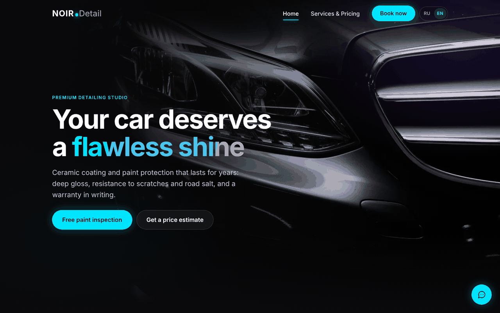

# NOIR Detail — landing page for a car detailing studio

**Live demo:** https://noirdetail1.netlify.app



A two-page website for a premium car detailing studio: ceramic coating, polishing, interior cleaning and PPF film. The goal of the site is to turn visitors into booked appointments, so every section leads to the booking form.

> **Concept project.** The studio, address, prices and contacts are fictional. The site was built as a portfolio piece to show what a small local business can get.

## Features

- **Price calculator.** The visitor picks a car class and services, sees the total instantly, and the result is passed straight into the booking form.
- **Two languages (RU / EN).** The language is detected from the browser, can be switched in one click and is remembered for the next visit.
- **Lead forms** with a phone input mask and field validation.
- **Before / after slider** to show the result of polishing.
- **Promo pop-up** with a discount and countdown.
- **Packages comparison table, FAQ, photo gallery with lightbox.**
- **Easy to edit.** All texts, prices and contacts live in one config object at the top of `js/main.js`, so the owner can update the site without touching the code.
- **SEO and sharing:** meta tags and Open Graph previews for messengers and social networks.
- **Accessibility:** skip link, ARIA labels, keyboard navigation, `prefers-reduced-motion` support.
- **Performance:** WebP images, lazy loading, no frameworks or build step.

## Tech stack

- HTML5, CSS3 (custom properties, responsive layout)
- Vanilla JavaScript (no frameworks)
- Hosting: Netlify

## Project structure

```
index.html       Home page
services.html    Packages, calculator and booking
css/style.css    Styles
js/main.js       Content config (SITE) + site logic
images/          Photos (WebP)
```

## How to change the content

Open `js/main.js` and edit the `SITE` object at the top of the file: contacts, prices, services, FAQ and texts. The English translation is in `SITE_EN` right below it.

## Lead delivery

Form submissions are handled by the `sendLead()` function in `js/main.js`. In this demo it only logs the lead to the console. For a real client it can be connected to a Telegram bot, email or a CRM.

## Run locally

No build is needed. Open `index.html` in a browser, or run a simple local server:

```
npx serve .
```

---

Made by **Amuna** ([@amuna-dev](https://github.com/amuna-dev)). Need a website like this for your business? Hire me on [Upwork](https://www.upwork.com/freelancers/~01e5e615ba4cd161e5).
